# Chapter 4 — Results

## 4.1 Basis of the reported results

This chapter reports the model’s results against the four questions set out in §1.4. Section 4.2 reports what limits the least-cost expansion pathway and the system-cost value of relieving each limit, with no policy in force and under a binding emissions commitment. Section 4.3 reports what is changed by determining each vintage’s division of capital within the model, and the conditions under which that determination changes nothing. Section 4.4 reports what determines the quantity of emissions outside the grid boundary and the effect of tightening a constraint at that boundary. Section 4.5 reports whether a deterministically-optimal plan retains capacity adequacy across demand realisations, whether the service standard’s specification changes what is observed, and the upper bound on the value of a formulation that does not assume a single future. The present section states the configuration, the reporting window and the conditions under which those results may be read; §4.6 summarises them.

### 4.1.1 Configuration and dispatch representation

The results reported in this chapter were produced with the sliced builder (§3.1.8) solved at the central configuration set out in §3.6.3, and at arms departing from it in the dimensions each section names. Every configuration below is described as a deviation from that set, naming the arms that differ. One element of it bears on every result and is repeated here: gas fleet availability is held at the nameplate value, which is the declared upper bound of a bracket whose lower bound is the measured figure, and no central value exists for that parameter (§3.7.5).

Generation from capacity added within the model converts fuel at the combined-cycle efficiency of §3.3.4; generation from the pre-existing fleet converts at the realised fleet value. Emissions follow the same division by vintage. Converted capacity retains its own stream and its own conversion rate.

All results were produced with a single solver at one tolerance setting (§3.1.1). The formulation is linear, so each solution is a global optimum and each constraint carries a dual value, read in this chapter as a shadow price. Where the optimal face is flat the vertex returned is solver-dependent, and §3.6.10 identifies the class of result exposed to that dependence.

### 4.1.2 Central solution

The central solution returns a discounted system cost of ⟦23,323,068,340.46⟧ United States dollars. Cumulative capacity at 2045 is ⟦11,788⟧ megawatts of solar, ⟦3,825⟧ megawatts of gas and ⟦24,698⟧ megawatt-hours of storage, reaching ⟦30,939⟧ megawatts, ⟦4,508⟧ megawatts and ⟦56,290⟧ megawatt-hours at the end of the solved horizon. Cumulative emissions are ⟦338.18⟧ megatonnes of carbon dioxide over 2025 to 2045 and ⟦504.11⟧ over the full horizon. Unserved energy is ⟦0.0⟧ terawatt-hours in both windows. The concessional envelope is drawn in full in a single vintage.

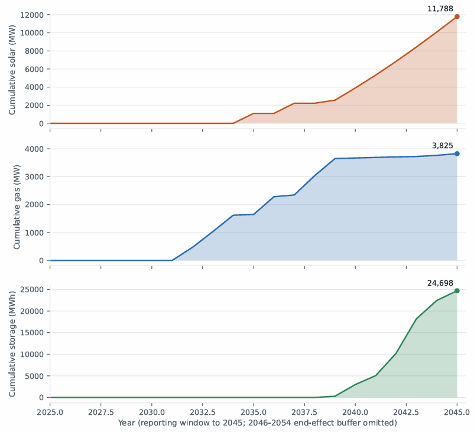{width="6.5in" height="5.932638888888889in"}

Figure 4.1 Cumulative solar, gas and storage capacity in the central solution, 2024-2045. Storage is read against the left-hand axis. Cumulative stocks are quantity reported as a result; the annual additions underlying them carry the horizon-sensitivity bound of 4.1.3. *Source: ‘results/baseline_scliced_summary_661b03c1.json’*

The objective decomposes into three terms. The discounted capital charge is ⟦9,329,045,793⟧ dollars, ⟦40.00⟧ per cent of system cost; fuel is ⟦32.25⟧ per cent; operation and maintenance is ⟦27.75⟧ per cent.

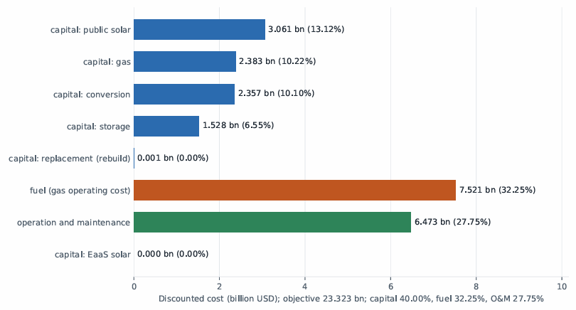{width="6.5in" height="3.498611111111111in"}

Figure 4.2 Decomposition of discounted system cost. The capital charge, fuel and operation and maintenance account for ⟦40.00⟧, ⟦32.25⟧ and ⟦27.75⟧ per cent respectively; the capital charge's five lines are shown separately. The service-financed solar line is zero at this configuration. *Source: \`results/baseline_sliced/diagnostics\_\_661b03c1.json\`.*

Capital raised is a distinct quantity from the capital charge. Gross capital expenditure over the reporting window is ⟦7,700,300,000⟧ dollars in present value, ⟦33.0⟧ per cent of system cost, and ⟦10,142,200,000⟧ over the full horizon, ⟦43.5⟧ per cent. The first ratio places a reporting-window numerator over a full-horizon denominator; both horizons are stated wherever such a ratio appears below.

### 4.1.3 Reporting window

The programme is solved over 2025 to 2054 and reported to 2045 (§1.6.3). The final nine years constitute an end-effect buffer from which no figure is reported as a result. The objective is a full-horizon discounted quantity, since truncation at 2045 would require the terminal salvage treatment the per-vintage formulation is constructed to avoid (§3.4.2).

The distinction between the two horizons is material. Terminal storage is ⟦56,290⟧ megawatt-hours against ⟦24,698⟧ at 2045, so a terminal figure quoted as a reporting-window quantity overstates it by more than a factor of two.

Cumulative stocks at 2045 are invariant to the position of the horizon end. At horizon ends of 2045, 2050 and 2054 the 2045 stocks agree to ⟦0.1⟧ megawatts. Annual addition series are not invariant: the timing of individual additions moves by up to ⟦1.9⟧ per cent in first-difference terms, with approximately ⟦48⟧ megawatts of solar and ⟦26⟧ megawatts of gas displaced between 2035 and 2037 as the horizon lengthens. The mechanism is lumpiness at the threshold at which new gas capacity becomes economic, and the effect vanishes when the two conversion efficiencies are set equal. Cumulative stocks are therefore reported as results; annual addition series are reported as illustration and carry that bound at each appearance.

### 4.1.4 Conditions on interpretation

Six conditions govern interpretation of the results below. Each follows from a property of the formulation established in Chapter 3 and is stated once here rather than at each result it qualifies.

Results turning on feasibility or on frontier position are invariant to the choice between availability arms, because under unconstrained gas build a lower availability is answered by additional capacity. Results turning on dual values are not invariant. Each section states which class its results fall in (§3.7.5).

Boundary-resolved results are lower bounds. Where a threshold is located on a search grid, the reported figure is bounded by that grid’s resolution. The grids resolve at their floor more frequently on the corrected model than on its predecessor: all eight reliability cells and twelve of twenty financing-frontier cells sit at the tightest grid value. No boundary-resolved figure is reported without that qualification.

Means taken over the years in which a constraint binds are composition artefacts, since such a mean mixes years of unequal weight and a small number of years dominates the dual series reported here. Maxima and medians are reported in preference to means.

Every shadow price exists on two bases, as a present value in base-year dollars and as a year-*t* quantity, differing by a discount factor reaching ⟦9.3⟧ at the end of the horizon. Each shadow price states its basis. Comparisons against benchmarks expressed in constant real prices use the year-*t* basis.

The capital tier names `tight`, `moderate`, `adequacy` and `expansion` denote fractions of a reference scale and not economic characterisations of the budget each sets. The reference scale exceeds the measured unconstrained requirement of ⟦5,518,409,480⟧ dollars by ⟦86.2⟧ per cent, so the four tiers correspond to ⟦0.931⟧, ⟦1.582⟧, ⟦1.862⟧ and ⟦2.234⟧ times that requirement. Where a result turns on whether the budget binds, the constraint’s dual is the quantity read and not the tier’s name (§3.4.4).

The service tariff, the rate at which grid revenue is collected and the grid-service obligation are each represented as a single national value over a system in which the corresponding legislative competence is divided between the Federation and the States (§1.2.3, §1.6.6). Results resting on any of the three describe a national average.

### 4.1.5 Robustness across the correction epochs

The results were produced after two sets of corrections to the formulation. The first revised the capital-charge timing, the storage capital cost series and the basis on which shadow prices are extracted. The second assigned capacity added within the model its own conversion efficiency in place of a single fleet-wide rate applied to all vintages, and corrected the provenance of the parameters governing it.

Forty findings were re-derived against the corrected results. Six were unchanged, fifteen moved in magnitude with their conclusions intact, ten were weakened, three were strengthened, five were reversed, and one could not be verified from the sources it names. The reversals and the weakened findings are identified at the results they concern, with the clause that moved stated in each case. Three of the five reversals share a single mechanism, set out in §4.4.2.

## 4.2 Determinants of system cost

### 4.2.1 Scope

Section 1.4 asks what limits the least-cost expansion pathway to 2045 and what the system-cost value is of relieving each limit. The limits it names are gas fleet availability, gas deliverability, conversion of existing open-cycle capacity and the retirement schedule of the existing fleet. It requires each to be measured as a span across a declared arm family, the capital-recovery span to be reported alongside, the hydro trajectory to be reported as a bound rather than a lever, and each limit to be measured both with no policy in force and under a binding emissions commitment.

### 4.2.2 Ranking rule

Seventeen parameter families are declared in the model’s scenario definitions, each a set of arms differing from the central configuration in one dimension. The ranking rule is applied uniformly across all seventeen. It is formulated for this study; no equivalent rule was identified in the reviewed literature, where one-at-a-time sensitivity results are ordinarily reported as cost spans without a test of whether the plan responds.

The **span** of a family is the difference between the largest and smallest discounted system cost across its arms, the central arm included. The **build response** of a family is whether its arms produce different capacity decisions, determined by exact comparison of the complete decision-variable block. A family is ranked where its arms produce more than one plan; a family producing a single plan is reported separately, its span measuring the cost of a plan determined elsewhere. An arm is **unasserted**, and excluded from its family’s span, where it is unsourced and represents no state or bound the thesis asserts, being retained only so that superseded results remain attributable; one arm meets this test, a retirement proxy whose source is recorded as pending. A family whose arms differ in dispatch representation is reported as not comparable and is not ranked, its span being a difference between two models rather than between two states of the system.

Two further categories are excluded from the ranking and are reported in §4.2.5.

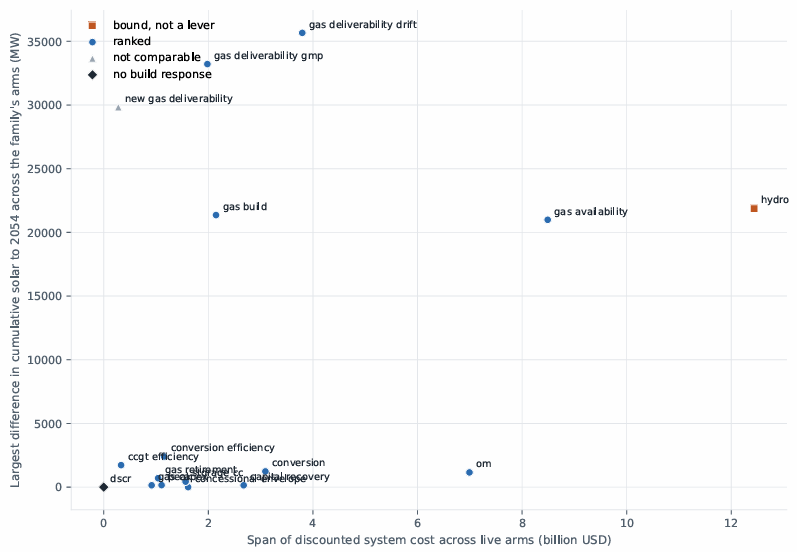{width="6.5in" height="4.502083333333333in"}

Figure 4.3 Each declared family's system-cost span against the extent to which its arms change the capacity decisions. The rule ranks a family only where the arms produce more than one plan; families with a large span and no build response rescale the cost of a plan determined elsewhere. Source: *\`results/lever_ranking/arms_661b03c1/lever_ranking.csv\`*

### 4.2.3 Build-responsive families

Fourteen families change the capacity decisions and are ranked by span.

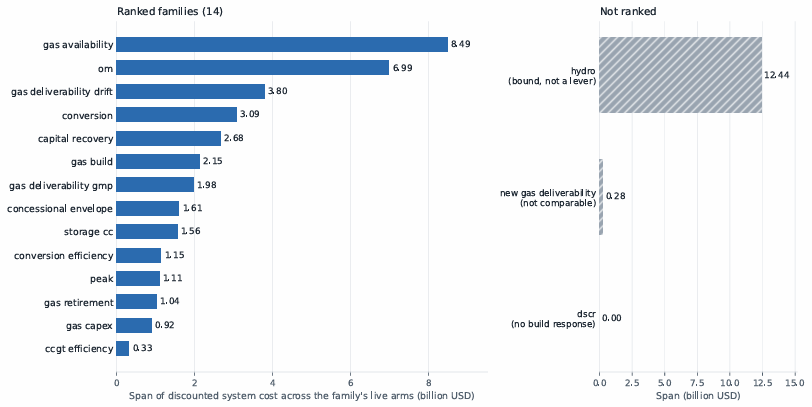{width="6.5in" height="3.2583333333333333in"}

Figure 4.4 System-cost span of each declared parameter family, with no policy in force, over its live arms. Fourteen families change the capacity decisions and are ranked. Three are reported separately: the hydro trajectory as a bound, since it carries no cost term; the treatment of new gas under the deliverability constraint as not comparable, since its arms differ in dispatch representation; and the coverage ratio, whose arms produce a single plan. *Source: \`results/lever_ranking/arms_661b03c1/lever_ranking.csv\`.*

Nine of the fourteen are properties of the gas system: the condition of the existing fleet, the operations permitted on it, the schedule on which it leaves service, the quantity of fuel reaching it, and the efficiency with which that fuel is converted. Of the remaining five, two are financing parameters, one a demand assumption, one a storage valuation parameter and one an operating cost. No solar-side parameter appears in the ranking at any position.

Gas fleet availability spans ⟦36.4⟧ per cent of central system cost between the nameplate value and the measured value, exceeding the capital-recovery span by a factor of ⟦3.17⟧. The two deliverability families, separated because they represent distinct kinds of uncertainty (§3.7.6), occupy third and seventh position.

Two rows carry qualifications the span does not convey. The arms of the concessional envelope family are identical in cumulative solar, gas and storage capacity at the end of the horizon to within ⟦0.0001⟧ megawatts; what differs between them is the timing of investment, and at the two largest scales approximately one seventh of the solar build is displaced in time, first differing between 2033 and 2035. Gas build availability and gas capital cost each have three arms and two distinct plans, one arm in each duplicating another’s decisions.

### 4.2.4 Financing arms and terminal capacity

Across the eleven arms varying only financing parameters — four capital-recovery cases, five envelope scales and two coverage-ratio cases — system cost spans ⟦2.675⟧ billion dollars, ⟦11.5⟧ per cent of the central value. Cumulative capacity at the end of the horizon moves by at most ⟦0.47⟧ per cent in solar and ⟦0.32⟧ per cent in storage, and ten of the eleven arms are identical in both quantities to the stored precision. The arms varying physical parameters move the same quantities by between ⟦2⟧ and ⟦100⟧ per cent; the availability arm alone moves terminal storage by ⟦26,900⟧ megawatt-hours and terminal solar capacity by ⟦20,986⟧ megawatts.

The separation between the two classes is one of magnitude and it holds at that level. It is not exact, and two qualifications attach to it. Three arms move the terminal plan — the high commercial rate, the high operating-cost case and the low gas capital cost — each by ⟦144⟧ megawatts of solar and ⟦120⟧ megawatt-hours of storage, and all three resolve to the same alternative vertex, which is the signature of a flat optimal face rather than of three independent responses. The timing of investment responds to financing: the concessional envelope family produces five distinct plans and displaces ⟦13.8⟧ and ⟦14.7⟧ per cent of the solar build in time at its two largest scales. What financing does not move is the composition of the portfolio at the end of the horizon.

The capital-recovery result bears directly on the per-vintage formulation of §3.4.2. Under the preceding specification the cost of capital reached no term in the objective, and halving it changed system cost by exactly zero (§3.4.1). Under the present specification it moves system cost by ⟦2.675⟧ billion dollars, produces three distinct build schedules, and changes the shadow price of fuel in every year the fuel constraint binds.

### 4.2.5 Quantities excluded from the ranking

The hydro trajectory spans ⟦12.438⟧ billion dollars, exceeding every family in the ranking. Hydro carries neither a capital nor an operating cost term in the objective (§3.7.4), so its span measures the value of a costless input rather than the consequence of a decision or of an uncertainty borne by any party. It is reported as a bound.

The social discount rate changes the unit in which every other figure is expressed rather than any property of the system, and its span exceeds the ranking in aggregate. It is reported as a convention rather than a determinant.

The treatment of new gas capacity under the deliverability constraint is not ranked, its two arms differing in dispatch representation: the exempted arm runs the single-stream representation that the results in this chapter otherwise replace. The coverage-ratio family has no build response at any arm, its two constraints pricing privately financed capacity that the traditional financing regime holds at zero.

### 4.2.6 Ranking under a binding emissions commitment

Section §1.4 requires each limit to be measured both with no policy in force and under a binding commitment, on the ground that the value of relieving a physical limit is not invariant to the presence of a commitment. The ranking in §4.2.3 is the unconstrained measurement. The same rule applied under the current Nationally Determined Contribution, conditional arm, with the public capital budget unconstrained so that the cap is the only binding policy, gives the order below.

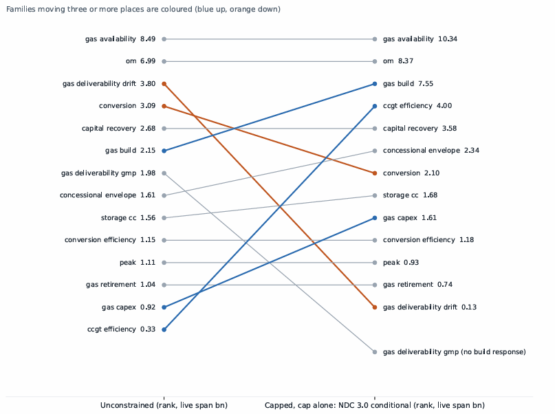{width="6.5in" height="4.848611111111111in"}

Figure 4.5 Each family's rank with no policy in force against its rank under the NDC 3.0 conditional cap, with the public capital budget unconstrained so that the cap is the only binding policy. Gas build availability rises from sixth to third and combined-cycle efficiency from fourteenth to fourth; the two deliverability families collapse to zero span. *Sources: \`results/lever_ranking/arms_661b03c1/\` and \`results/lever_ranking_capped/ndc3_conditional_noenvelope/arms_4ca4832d/\`.*

  -----------------------------------------------------------------------
  Rank    Family                                   Span (bn USD)
  ------- ---------------------------------------- ----------------------
  1       Gas fleet availability                   ⟦10.336⟧

  2       Operation and maintenance                ⟦8.369⟧

  3       Gas build availability                   ⟦7.555⟧

  4       Combined-cycle efficiency                ⟦4.003⟧

  5       Capital recovery                         ⟦3.578⟧

  6       Concessional envelope                    ⟦2.344⟧

  7       Conversion                               ⟦2.103⟧
  -----------------------------------------------------------------------

Under the unconditional arm the first three positions are gas availability at ⟦9.277⟧, gas build availability at ⟦8.959⟧ and operating cost at ⟦8.292⟧ billion dollars. The cap binds in all ⟦58⟧ declared arms at both stringencies, in between ⟦10⟧ and ⟦30⟧ of the thirty solved years, and no arm is infeasible.

Three changes against the unconstrained ranking are substantive. Gas build availability rises from sixth to third, and to second under the tighter arm. Combined-cycle efficiency rises from fourteenth to fourth. Both reflect the value of replacing inefficient capacity with efficient capacity when the emissions constraint binds.

The deliverability families collapse. All four arms of the Master Plan family return capped objectives identical to the cent, and three of the four drift arms likewise. The exception is the downside regime, in which supply is scarce enough to bind independently of the cap; relief there is worth ⟦0.129⟧ billion dollars under the conditional cap and ⟦0.658⟧ under the unconditional. A cap on emissions is a cap on fuel burned, so fuel the system may not burn carries no value. The result holds whether or not a capital budget is simultaneously in force; its magnitude does not. With a budget constraint added the downside figures are ⟦0.705⟧ and ⟦7.251⟧ billion dollars, five and eleven times larger, which is an effect of the budget and not of the cap.

### 4.2.7 Summary of determinants

The determinants of cost are predominantly gas-side. Nine of the fourteen ranked families are properties of the existing fleet, of the fuel reaching it, or of the efficiency of conversion; they occupy the first, third, fourth, sixth, seventh, tenth, twelfth, thirteenth and fourteenth positions, and no solar-side parameter appears.

Gas fleet availability is the largest determinant among the parameters that change the capacity decisions, at ⟦36.4⟧ per cent of central system cost with no policy in force and at the first position under a binding commitment. It is not the largest span in the model; hydro and the social discount rate exceed it, and each is excluded on a stated ground.

Variance-based sensitivity analysis over the five parameters carrying independent priors, following the first-order and total-effect indices of Sobol’ (Sobol’ 1993; Saltelli et al. 2010), assigns gas availability a first-order index of ⟦0.9466⟧ on system cost and ⟦0.9545⟧ on capital mobilised. The remaining four parameters together account for ⟦5.3⟧ per cent of the variance in cost. The parameter dominating the model’s output is one whose upper endpoint is an assumption and whose lower endpoint is a measurement (§3.7.5).

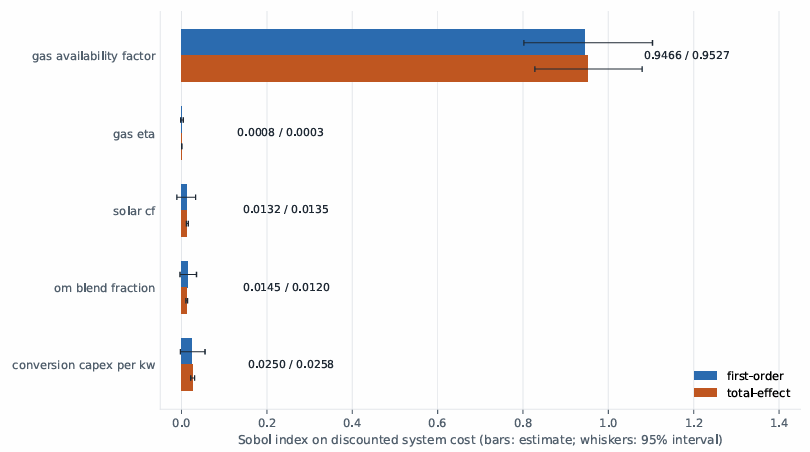{width="6.5in" height="3.627083333333333in"}

Figure 4.6 First-order and total-effect variance indices on discounted system cost, over the five parameters carrying independent priors. Gas fleet availability accounts for ⟦0.9466⟧ of the first-order variance; the remaining four together account for ⟦5.3⟧ per cent.

## 4.3 Endogenous capital structure

### 4.3.1 Scope

Section 1.4 asks what is changed by determining each vintage’s division between concessional and commercial capital within the model rather than supplying it, and under what conditions that determination changes nothing. It does not ask the same of the division between publicly and service-financed capacity, which lies on a flat optimal face and is not identified by the formulation (§3.4.4).

### 4.3.2 The value of determining the division

The division is measured by supplying it. Two exogenous rules replace the model’s own choice, each fixing the concessional share of every vintage as data: a constant share across all eligible vintages, set so that the concessional facility is exhausted over the plan; and the whole facility assigned to the first vintage in which the model builds. Both leave the formulation linear and neither alters any other parameter. Supplying the model’s own realised shares reproduces the endogenous solution to ⟦8.86⟧ dollars on an objective of ⟦23.3⟧ billion, and supplying zero shares reproduces the no-facility case exactly.

Facility Endogenous (bn) Constant share Front-loaded ⟦0.75⟧ bn ⟦23.323⟧ ⟦+135.9⟧ M, ⟦0.58⟧ % ⟦+0.0⟧ M ⟦1.05⟧ bn ⟦23.239⟧ ⟦+185.8⟧ M, ⟦0.80⟧ % ⟦+0.0⟧ M ⟦3.75⟧ bn ⟦22.606⟧ ⟦+512.8⟧ M, ⟦2.27⟧ % ⟦+96.5⟧ M, ⟦0.43⟧ % ⟦7.50⟧ bn ⟦21.933⟧ ⟦+758.6⟧ M, ⟦3.46⟧ % ⟦+458.2⟧ M, ⟦2.09⟧ %

The quantity those differences should be read against is the value of the facility itself. Removing the concessional facility entirely raises system cost to ⟦23,544,938,934⟧ dollars, so at its actual size the facility is worth ⟦221.9⟧ million. Determining its allocation within the model is worth ⟦135.9⟧ million of that — ⟦61⟧ per cent of the facility’s value lies in allocating it rather than in having it. At ten times the size the facility is worth ⟦1,612⟧ million and allocation is ⟦759⟧ million, ⟦47⟧ per cent.

### 4.3.3 The conditions under which it changes nothing

The determination changes nothing when the supplied rule happens to coincide with the allocation the model would choose. At the actual facility size the model draws the entire ⟦750⟧ million in a single vintage, 2035, and a rule that front-loads the facility into the first vintage the plan builds reproduces the endogenous solution to ⟦8.86⟧ dollars. The same rule at ten times the facility costs ⟦458⟧ million more, because the model then spreads the facility across four vintages at full share and several more in part.

The determination therefore matters in proportion to how much allocation there is to get wrong. A small facility has one sensible destination and any rule that finds it is as good as the model; a large facility has many, and the constant-share rule, which spreads the facility thinly across eighteen vintages with most of it falling after 2045, forgoes ⟦3.46⟧ per cent of system cost at that scale.

The condition is not the one that governs the service-financed channel in §4.3.4, and the two should not be read as one mechanism. The value measured here depends on the concessional facility binding, not on the public capital budget: the configurations above carry no capital budget at all, and the value is positive at every facility size. Nor is the separation sharp. The value varies continuously with facility size and with the rule supplied, which is what distinguishes a quantity determined by a resource limit from one determined by a budget constraint that either binds or does not.

### 4.3.4 The conditionality of the service-financed channel

A separate question, measured separately, concerns the channel through which capacity is financed rather than the division of capital within a vintage. Across thirty-six configurations spanning demand growth, gas availability and cap stringency, the value of raising solar capacity through the service-financed channel rather than on the public account is determined by whether the public capital budget constrains the solution.

The thirty-six configurations do not divide independently. Every configuration at the lowest demand growth rate falls in the zero-dual group and every one at the highest falls in the positive-dual group; only the central growth rate divides, six and six, according to the gas case and the cap. What determines whether the budget binds is therefore principally the rate at which demand grows, and the separation rests on three demand levels rather than on thirty-six independent variations.

The separation is exact. In the eighteen configurations where the budget’s shadow price is zero, the value of the service-financed channel does not exceed ⟦−0.61⟧ dollars, a magnitude on an objective of order ten billion that represents solver agreement rather than a quantity. In the eighteen where the shadow price is positive, the value is never below ⟦653,600,175⟧ dollars. No configuration lies between, and the interval separating the two groups spans nine orders of magnitude.

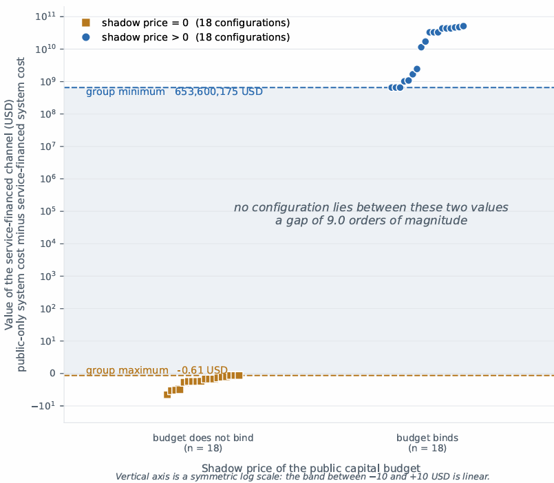{width="6.5in" height="5.668055555555555in"}

Figure 4.7 The value of raising solar capacity through the service-financed channel rather than on the public account, across thirty-six configurations of demand growth, gas availability and cap stringency, grouped by whether the public capital budget's shadow price is zero. In the eighteen configurations where it is zero the value does not exceed ⟦−0.61⟧ dollars; in the eighteen where it is positive the value is never below ⟦653,600,175⟧ dollars, and no configuration lies between. The quantity plotted is the value of the financing channel, not the value of determining the concessional–commercial division, which §4.3.2 reports separately. Source: results/dem2/arms_1fa34539/eaas_value.csv.

The mechanism is the geometry of the optimal face. Where the budget does not bind, public and service-financed capital are perfect substitutes at the margin and the division between them is a face rather than a vertex; the solver returns a point on it, and a different solver or tolerance returns a different point on the same face. Where the budget binds, the face collapses to a vertex. The property is one of the formulation rather than of the numerical values, which is why the separation is exact rather than approximate.

A related measurement bounds how much public capital each regime requires. On an uncapped run, the public capital budget ceases to bind at between ⟦5.137⟧ and ⟦5.518⟧ billion dollars under the traditional regime and between ⟦1.541⟧ and ⟦2.055⟧ billion under the service-financed one, a reduction of ⟦60.0⟧ to ⟦62.8⟧ per cent. That is a property of the financing channel and not of determining the division within a vintage.

### 4.3.5 What determination changes in the plan

At the actual facility size, supplying the division changes system cost and the timing of investment but not the capacity in place by 2045. At larger facilities it changes that too: under the constant-share rule cumulative solar at 2045 falls by ⟦88.6⟧ megawatts at five times the facility and ⟦130.1⟧ megawatts at ten times.

The allocation the model chooses when free to do so is concentrated and early. At the actual facility size it places the whole facility in 2035; at ten times it uses 2033, 2034, 2035 and 2038 at full share before taking partial shares in later vintages. The constant-share rule places ⟦2.80⟧ per cent of each vintage’s capital concessionally across eighteen vintages, most of them beyond the reporting window.

### 4.3.6 Composition of the capital programme

The programme whose division is being determined has a different composition on the corrected model. Of the ⟦40.00⟧ per cent of system cost accounted for by the capital charge, public solar is ⟦13.1⟧ percentage points, gas ⟦10.2⟧, conversion ⟦10.1⟧ and storage ⟦6.5⟧. Under the preceding specification public solar alone was ⟦22.2⟧ points and gas ⟦2.5⟧; the gas capital charge rises by a factor of ⟦3.75⟧, from ⟦0.635⟧ to ⟦2.383⟧ billion dollars.

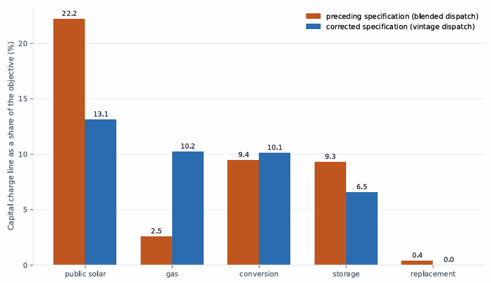{width="6.5in" height="3.7472222222222222in"}

Figure 4.8 The capital charge's composition under the preceding dispatch specification and under the corrected one, as percentages of system cost. Public solar falls from ⟦22.2⟧ to ⟦13.1⟧ per cent while the gas capital charge rises by a factor of ⟦3.75⟧. The comparison is between two model specifications, not between two scenarios. Sources: results/baseline_sliced/diagnostics\_\_6046f759.json and diagnostics\_\_661b03c1.json.

The capital programme is therefore divided in approximately equal shares between solar capacity, new gas capacity and the conversion of existing gas capacity. The concessional envelope’s eligibility convention restricts it to solar and storage capacity (§1.5.2), which together account for ⟦49.2⟧ per cent of the capital charge against ⟦71.8⟧ per cent under the preceding specification. The envelope therefore reaches a smaller fraction of the programme than it did, and the fraction it reaches is roughly half rather than the whole of the capital-intensive part of the plan.

## 4.4 Emissions outside the grid boundary

### 4.4.1 Scope

Section §1.4 asks what determines the quantity of emissions outside the grid boundary and how tightening a constraint at that boundary affects national emissions. The quantity is self-generation displaced beyond the cap’s reach, which is the definition of leakage adopted in §3.5.6 (IPCC 2007, §11.7.2). The post-solve diagnostic reports the out-of-boundary share of emissions, which is a level rather than a displacement; the leakage quantity is the increment of that share over the same configuration solved without the cap. On the results reported here the two coincide, because the uncapped configurations produce no self-generation at all. The diagnostic sums over the whole solved horizon; the shares reported below are recomputed over the reporting window, and the two bases differ materially.

### 4.4.2 Determinants of leakage

A cap applied to grid emissions alone can raise emissions outside the boundary by displacing demand to self-generation, which is unregulated and less efficient per unit delivered. Whether it does so depends on whether the system has an alternative means of meeting that demand inside the boundary.

At the central configuration under the current commitment, with the cap as the only binding policy, the system does displace demand beyond the boundary. Self-generation runs at ⟦32.3⟧ megatonnes across 2031 to 2038, giving an out-of-boundary share over the reporting window of ⟦12.76⟧ per cent, above the ⟦10⟧ per cent threshold. Under the unconditional arm of the same commitment the displacement is ⟦0.37⟧ megatonnes, confined to 2032 and 2033.

The basis on which the share is taken changes the picture entirely. Measured over the whole solved horizon, ⟦7⟧ of the ⟦58⟧ declared arms exceed the threshold under the conditional cap; measured over the reporting window, ⟦55⟧ of ⟦58⟧ do. The conditional cap’s displacement is front-loaded, falling in the years before 2038, and the horizon sum dilutes it against three decades of emissions. The unconditional cap’s displacement is back-loaded and the horizon sum overstates it against the reporting window.

Imposing a public capital budget alongside the cap raises the displacement further. On the reporting window, with the budget at the tier named tight, the out-of-boundary share runs between ⟦3.9⟧ and ⟦8.8⟧ per cent across collection rates; at the tier named moderate it runs between ⟦0.0⟧ and ⟦0.14⟧ per cent. Each of those is also the policy-induced increment, since the corresponding uncapped configurations produce no self-generation on either basis.

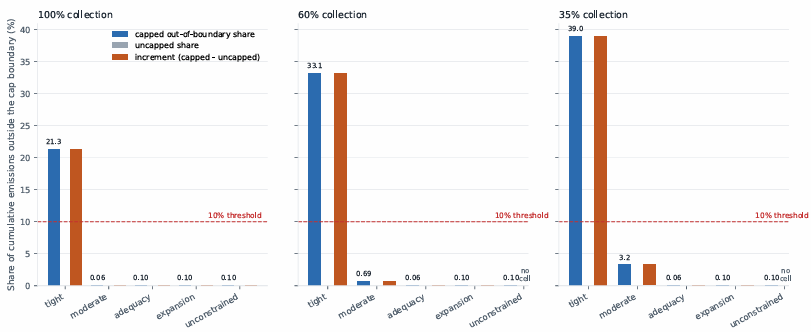{width="6.5in" height="2.661111111111111in"}

Figure 4.9 The share of emissions falling outside the cap boundary over the reporting window, by capital tier and collection rate, under each arm of the current commitment. The ⟦10⟧ per cent threshold is a declared judgement rather than a derived quantity (§3.5.6). Under the unconditional arm the capital tier determines the share, which runs from ⟦0.0⟧ per cent at the moderate tier to ⟦8.8⟧ per cent at the tight one; under the conditional arm the commitment itself displaces demand and the share exceeds the threshold at every tier. The quantity plotted is the out-of-boundary level, which equals the policy-induced increment here because the corresponding uncapped configurations produce no self-generation. Sources: results/fin3/arms_1d68be49/, arms_7f91f752/

Two determinants therefore operate, and they are distinguishable. The capital constraint raises the out-of-boundary share by roughly two orders of magnitude between the moderate and the tight tier, on either basis. The commitment itself also produces displacement, which the horizon-cumulative basis conceals under the conditional cap and exaggerates under the unconditional one. A cap imposed on a system able to finance compliance does not eliminate displacement; it reduces it, and the reduction is large.

### 4.4.3 Effect of cap tightening

Tightening a grid-only cap does not raise national emissions over the reporting window. Comparing a cap declining after 2035 against one held flat, national emissions over 2025 to 2045 are lower under the declining cap, both with and without a capital budget in force. An increase appears only when the sum is taken over the full solved horizon and only where a budget binds simultaneously .

Two qualifications attach. Where leakage is present at any level, the abatement achieved nationally is a fraction of that achieved at the grid boundary, so a grid-only instrument remains an inefficient route to national abatement even where it does not reverse. Where self-generation does respond, part of the response precedes the tightening: under the declining cap the additional self-generation appears between 2031 and 2034, while the declining cap is still identical to the flat one. Perfect foresight permits anticipation of a future constraint, which is a property of the formulation (§3.7.2).

### 4.4.4 Carbon price under a binding capital budget

A carbon price applied where the public capital budget binds produces abatement. At the tier named tight, raising the price to ⟦150⟧ dollars per tonne reduces cumulative emissions by ⟦64.1⟧ megatonnes, ⟦12.7⟧ per cent, and the increase in system cost exceeds the carbon payment collected. At zero carbon price the tight tier emits the quantity the unconstrained budget emits and builds no self-generation.

A capital budget constrains which abatement options can be financed; it does not prevent abatement. This is the mechanism of §4.4.2 observed through a different instrument.

### 4.4.5 Cost–emissions frontier

Scanning the cap from its loosest to its tightest feasible value traces a frontier that bends backward: beyond a threshold, tightening the cap raises total national emissions while raising system cost. Under public financing at the tier named moderate, the turning point over the reporting window lies at a cap fraction of ⟦0.5875⟧, at which national emissions reach ⟦213.2⟧ megatonnes against ⟦329.7⟧ at the loosest sampled cap and ⟦338.2⟧ with no cap in force. The cap grid is sampled at ⟦31⟧ values and steps by ⟦0.0375⟧ in this region, so the minimum is bracketed between ⟦0.6250⟧ and ⟦0.5500⟧ and is the lowest sampled point rather than a located optimum.

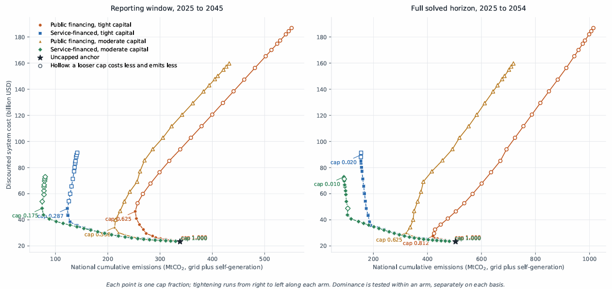{width="6.5in" height="3.0770833333333334in"}

Figure 4.10 Discounted system cost against national cumulative emissions as the cap is tightened, for four financing arms, on the reporting window (left) and the full solved horizon (right). Each point is one cap fraction; tightening runs from right to left along each arm, and the turning point and the loosest sampled cap are labelled on each. Under public financing at the moderate tier the turning point on the reporting window lies at a cap fraction of ⟦0.5875⟧. Hollow markers are dominated within their own arm on that panel’s basis: a looser cap costs less and emits less. The tight end of the frontier is unlocated — every point down to a cap fraction of ⟦W-lo⟧ remained feasible in all four arms. *Source: results/pareto_frontier/arms_1d68be49/pareto_raw.csv.*

The bend appears in all four arms on this basis. Under public financing ⟦12⟧ of ⟦31⟧ sampled points are non-dominated at the moderate tier and ⟦11⟧ of ⟦31⟧ at the tight tier, turning at ⟦0.6250⟧. Under service-financed capital the turning points lie further into the scan — ⟦0.2875⟧ at the tight tier with ⟦20⟧ of ⟦31⟧ non-dominated, and ⟦0.1750⟧ at the moderate tier with ⟦23⟧ of ⟦31⟧ — so the service-financed arms tolerate a much tighter cap before tightening becomes counter-productive, but they do not escape the bend.

The same scan over the full solved horizon gives different turning points and conceals two of the four bends. There the service-financed arms turn only at the two tightest sampled caps, ⟦0.02⟧ and ⟦0.01⟧, with ⟦29⟧ of ⟦31⟧ points non-dominated in each, which is indistinguishable from no bend at all. The reporting window is the basis used in this chapter (§4.1.3); both are shown in Figure 4.10 because the cap trajectories themselves run to 2054 and a reader checking a stored result will find the horizon quantity there. Both lie at the last and second-to-last sampled caps, so neither is bracketed below and the scan does not extend far enough to locate either turning point.

The tight end of the frontier is not located. Every point down to a cap fraction of ⟦0.0100⟧ remained feasible in all four arms, so the scan does not establish the point at which infeasibility begins and no statement is made about it.

## 4.5 Adequacy across demand realisations

### 4.5.1 Scope

Section §1.4 asks whether a deterministically-optimal plan retains capacity adequacy across realisations, whether the service standard’s specification changes what is observed, and what upper bound can be placed on the value of a formulation that does not assume a single future.

### 4.5.2 Adequacy of a committed plan

A plan optimised against the central demand realisation and then held fixed is infeasible against ⟦50⟧ of ⟦100⟧ sampled realisations. The same draws solved with the plan free are feasible in all ⟦100⟧.

The deterministically-optimal plan carries no adequacy margin: it fails against half the futures it is required to meet, and the failures are not confined to the extreme draws. The result follows from cost-minimisation under a single assumed future, which gives the plan no reason to carry capacity that future does not require, rather than from the parameter values of this model. The leg from which that result comes holds gas capacity fixed as well as the rest of the plan; the leg behind the cost distribution of §4.5.4 fixes the plan but leaves gas free, and is feasible in all ⟦100⟧ draws.

### 4.5.3 Service standard specification

The reliability standard may be written as a budget over the whole horizon or as a constraint applying in each year. The two are not equivalent, and the horizon form is the weaker, permitting years above the annual standard provided the horizon total remains within budget.

On the corrected model the difference is observable at the measured availability arm and not at the nameplate arm. At the measured arm the horizon form leaves ⟦2⟧ years above the ten per cent standard, worst case ⟦0.1551⟧, expending ⟦20.8⟧ per cent of the horizon budget, where the annual form leaves none. At the nameplate arm neither form leaves any year above the standard.

A second comparison cannot be reproduced. Determining which determinant each form understates requires the search grids to resolve above their floor, and on the corrected model all eight cells resolve at the tightest grid value in both forms. The determinant is recorded as indeterminate and the magnitudes reported under the preceding specification are withdrawn rather than restated.

### 4.5.4 Upper bound on the value of a stochastic formulation

The difference between the expected cost of a plan committed before the realisation is known and the expected cost of plans chosen with perfect foresight is ⟦12,089,071,820.50⟧ dollars, ⟦33.26⟧ per cent of the committed-plan expected cost of ⟦36,342,551,606.37⟧. The wait-and-see expectation is ⟦24,253,479,785.88⟧.

The quantity bounds the value of the stochastic solution and the expected value of perfect information jointly, in the sense of Birge and Louveaux (Birge and Louveaux 2011, ch. 4), and does not separate them. The value of solving the problem stochastically lies in the interval ⟦0⟧ to ⟦12.089⟧ billion dollars; this study does not locate it within that interval.

Both expectations are means over a right-skewed distribution and are reported with their medians. Per-draw committed cost has a median of ⟦25.71⟧ billion dollars against a mean of ⟦36.34⟧, a ratio of ⟦1.41⟧, with tenth and ninetieth percentiles of ⟦20.67⟧ and ⟦70.30⟧ billion. The wait-and-see median is ⟦23.76⟧ against a mean of ⟦24.25⟧. The bound is driven substantially by the upper tail of the committed-plan distribution, which is the tail reported as infeasibility in §4.5.2.

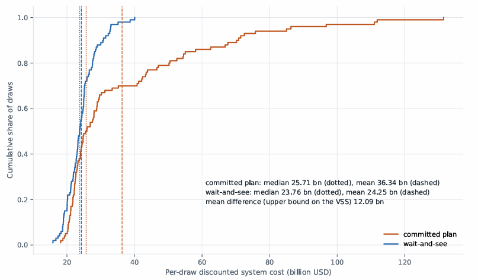{width="6.5in" height="3.801388888888889in"}

Figure 4.11 Distribution of system cost across ⟦100⟧ demand realizations, for a plan committed before the realization is known and for plans chosen with perfect foresight, with means and medians marked. Both legs are solved with the public capital budget unconstrained. The committed leg shown here is feasible in all ⟦100⟧ draws; the infeasibility result of §4.5.2 comes from a different leg, which fixes gas capacity as well as the rest of the plan.

Both legs run with the public capital budget unconstrained, so the bound is driven substantially by the upper tail of the committed-plan distribution.

## 4.6 Summary of results

The cost of the pathway is governed by the gas system. Nine of the fourteen ranked families are gas-side, gas availability alone accounts for approximately nineteen twentieths of the variance in both system cost and capital mobilised, and no solar-side parameter enters the ranking at any stringency. The dominant parameter has an assumed upper endpoint and a measured lower endpoint.

Determining the allocation of a finite concessional facility within the model is worth between ⟦0.58⟧ and ⟦3.46⟧ per cent of system cost, rising with the facility’s size, and at the facility’s actual size that allocation carries ⟦61⟧ per cent of the facility’s whole value. Separately, the value of financing capacity through a service-financed channel rather than on the public account is determined exactly by whether the public capital budget binds.

Emissions outside the grid boundary are raised both by the commitment and by the capital constraint, and the capital constraint is the larger of the two. On the reporting window a tight capital budget raises the out-of-boundary share by roughly two orders of magnitude against a moderate one. Tightening a grid-only cap does not raise national emissions within the reporting window.

A deterministically-optimal plan is infeasible against half the futures it is required to meet, and the value of foresight is bounded above by approximately one third of the expected cost of planning without it.

Appendix

  ------------------------------------------------------------------------------------
  **Rank**   **Family**                    **Span (bn USD)**   **% of central cost**
  ---------- ----------------------------- ------------------- -----------------------
  1          Gas fleet availability        ⟦8.490⟧             ⟦36.4⟧

  2          Operation and maintenance     ⟦6.994⟧             ⟦30.0⟧

  3          Gas deliverability drift      ⟦3.796⟧             ⟦16.3⟧

  4          Conversion                    ⟦3.091⟧             ⟦13.3⟧

  5          Capital recovery              ⟦2.675⟧             ⟦11.5⟧

  6          Gas build availability        ⟦2.146⟧             ⟦9.2⟧

  7          Deliverability, Master Plan   ⟦1.981⟧             ⟦8.5⟧

  8          Concessional envelope         ⟦1.612⟧             ⟦6.9⟧

  9          Storage capacity credit       ⟦1.565⟧             ⟦6.7⟧

  10         Conversion efficiency         ⟦1.152⟧             ⟦4.9⟧

  11         Demand shape                  ⟦1.106⟧             ⟦4.7⟧

  12         Gas retirement                ⟦1.039⟧             ⟦4.5⟧

  13         Gas capital cost              ⟦0.915⟧             ⟦3.9⟧

  14         Combined-cycle efficiency     ⟦0.331⟧             ⟦1.4⟧
  ------------------------------------------------------------------------------------
